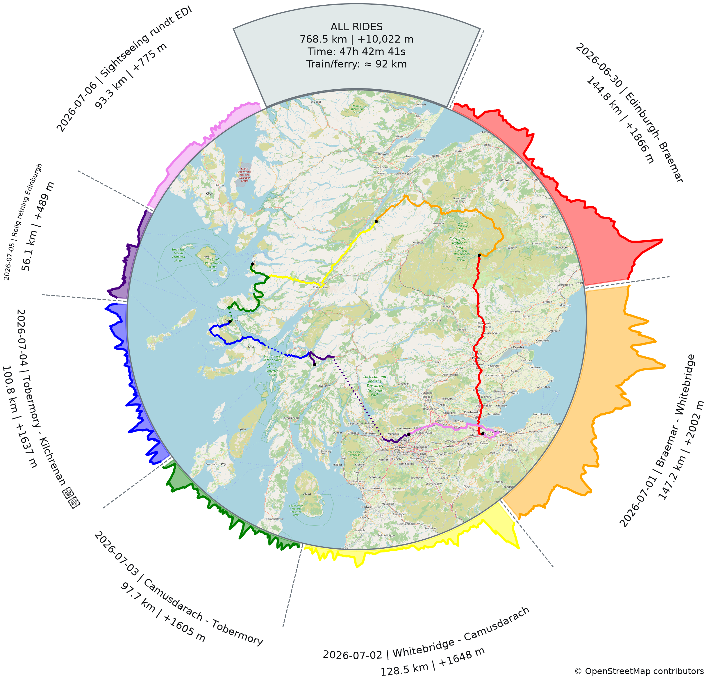

# Generate activity wheel

Python script for generating an activity wheel infographics for multi day rides based on gpx data.

## Example output

Example output for a weeks trip to Scotland. 

[Interactive map demo](https://thomiz.github.io/route-tools/activity_wheel.html)

## Features

It reads all .gpx files in a folder (which you can export from Strava or any GPS device), places a cropped OpenStreetMap of your riding area in the center circle, wraps the continuous elevation profile of every ride around the perimeter, and labels each segment with the date, track name, distance, and elevation gain. It uses the first named track containing points, or the filename if no such name is available.

Ride labels curve along the rim, and each ride sector is proportional to its
share of the total distance. Zero-distance rides contribute to the totals but
have no sector. The top sector shows total distance, elevation gain, and elapsed
time (including pauses within recorded track segments, except train and ferry
rides). If only some rides have usable timing data, the time is marked partial.
OpenStreetMap attribution appears in the bottom-right corner of the image.
The output is cropped to the infographic with approximately 10 pixels of
padding on each edge.

Routes and their elevation profiles share a color for each day, cycling through
red, orange, yellow, green, blue, indigo, and violet. Rides with the same
displayed date use the same color. When a ride has no recorded start time, its
displayed date uses the first 10 characters of its filename. Black dots mark
the end of each GPX track.
The map uses higher-detail tiles and is rendered at the output resolution
by default, while retaining the same geographic coverage.

### Train and ferry rides

If you pause recording on a train or ferry, the GPX file has a long time gap
between two points. A gap of at least 10 minutes where the position moves at
least 1 km is treated as a train or ferry ride. Shorter stops, and longer stops
where you stayed in place (such as a café break), still count as part of the
ride.

- The map shows a train or ferry ride as a dotted line in the day's colour
  between the two points, with no black end dot.
- Its distance, time and elevation change are excluded from the ride's
  distance, elapsed time, and elevation gain, so all totals cover cycling
  only. The summary sector adds a separate `Train/ferry: ≈ … km` line.
- The distance is a straight line, so it underestimates the real route. The
  script cannot tell a train from a ferry.
- In the interactive day view, the elevation profile is split at each train or
  ferry ride and marked with a dotted line, so the height difference between
  stations is not shown as a climb.

Use `--transit-gap-min MINUTES` and `--transit-min-km KM` to change the
thresholds. If you stop recording and start a new GPX file after the train or
ferry, add `--transit-between-files`. A dotted line is then also drawn between
consecutive rides on the same date when they are at least that far apart in
both time and distance. This option is off by default, because a gap between
files may also be a car journey or a sorting issue.

~~~powershell
python src\generate-wheel.py "C:\path\to\gpx_tracks" --transit-gap-min 15 --transit-min-km 2 --transit-between-files
~~~

## Prerequisites

Install the required libraries using pip:
~~~bash
pip install gpxpy matplotlib numpy requests pillow
~~~

## Run script

Run the script with the directory containing your GPX files:

~~~powershell
python src\generate-wheel.py "C:\path\to\gpx_tracks"
~~~

### Arguments and switches

The directory argument is optional and defaults to `./gpx_tracks`. The generated
`activity_wheel.png` is saved in the repository's `docs` folder, which is
created automatically, regardless of the GPX folder or working directory.
An explicit `--output` path overrides this default. The script needs
internet access to download map tiles from `tile.openstreetmap.org`.

Use `--map-scale PERCENT` from **100 to 400 percent** (default: **100**) to
make basemap labels larger by using less-detailed map tiles. At 200%, tiles
come from one zoom level lower, making place labels approximately twice as
large; 400% uses two levels lower. Intermediate values are rounded to the
nearest tile zoom-level scale because tile zoom levels are discrete.

The basemap is resized to the final map resolution **before** drawing GPS
tracks, black end dots and dotted transit connections. These overlays are
always drawn at native output resolution: their positions, widths and sizes
do not change with `--map-scale`. The final PNG size, geographic coverage,
layout and information text resolution also stay unchanged.
This option is not available with `--interactive`.

~~~powershell
python src\generate-wheel.py "C:\path\to\gpx_tracks" --map-scale 200
~~~

The default background is dark. Use `--background white` for a white image, or
`--background transparent` for a transparent PNG. For transparency, choose
`--transparent-theme light` (the default, with dark labels for a light
background) or `--transparent-theme dark` (with light labels for a dark
background). The map and summary sector remain visible.

~~~powershell
python src\generate-wheel.py "C:\path\to\gpx_tracks" --background transparent --transparent-theme dark
~~~

If the default output cannot be written, use `--output` to choose another
filename in an existing writable folder:

~~~powershell
python src\generate-wheel.py "C:\path\to\gpx_tracks" --output "$env:TEMP\activity_wheel_new.png"
~~~

### Interactive HTML pages

Use `--interactive` to write two linked HTML pages instead of the PNG:

~~~powershell
python src\generate-wheel.py "C:\path\to\gpx_tracks" --interactive
~~~

Both pages are saved in the repository's `docs` folder by default.

- `activity_wheel.html` is the interactive activity wheel. Click a ride's
  elevation profile, its label or its route on the centre map to open that day.
  Hover over a ride's sector or its map route to highlight both. Highlighting
  is per ride, even when several rides share a date; dotted train/ferry
  connections are included. Keyboard focus on a sector also highlights its route.
- `activity_wheel_day.html` shows the selected day on a zoomable map, with an
  elevation profile underneath. The profile is coloured by gradient (see the
  legend on the page), and hovering over the profile or the route shows the
  same position on both. Rides on the same date are shown together, with
  dashed lines between them in the profile. Use **← Activity wheel** to
  return, or the previous/next links to change day.

With `--output`, the wheel page uses the given `.html` filename and the day
page is saved next to it with `_day` added to the name. Keep the two files in
the same folder. The pages load Leaflet and the map tiles from the internet
when opened. `--background` and `--transparent-theme` also set the page colours.

### Publish on GitHub Pages

Generate the interactive pages, then commit and push the `docs` folder.
In the repository's **Settings → Pages**, choose **Deploy from a branch**,
select the publishing branch and the **/docs** folder, then save.
Open `https://thomiz.github.io/route-tools/activity_wheel.html` once deployed.
Keep both generated HTML files together so their navigation links work.

These are static pages; no Python server is needed on your computer when
viewing the published site. Internet access is still required for Leaflet and
map tiles. Open the HTTPS site rather than local `file://` pages, which may
have their OpenStreetMap tile requests blocked due to a missing Referer.
Review the embedded route locations before publishing: the generated pages
contain the route data and will be publicly accessible.

## How to use with Strava Data

1. Export from Strava:
   1. Single rides: Open any activity on Strava → click the ... (More) icon → Export GPX.
   2. Bulk export: Go to Strava Settings → My Account → Download or Delete Your Account → Request Your Archive. Unzip the archive and copy the .gpx files from the activities folder into your chosen GPX directory. (Note: If your bulk archive contains .fit.gz files instead of .gpx, you can convert them using gpsbabel or fitparse.)

