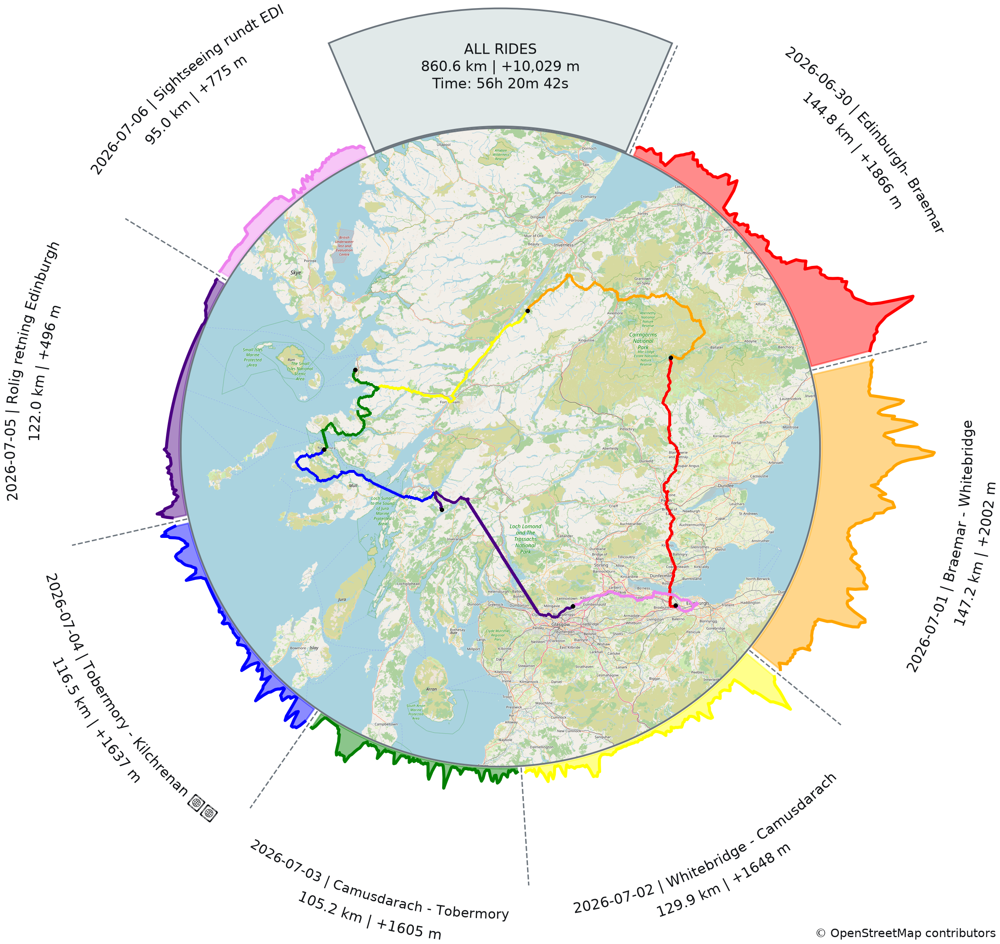

# Generate activity wheel

Python script for generating an activity wheel infographics for multi day rides based on gpx data.

## Features

It reads all .gpx files in a folder (which you can export from Strava or any GPS device), places a cropped OpenStreetMap of your riding area in the center circle, wraps the continuous elevation profile of every ride around the perimeter, and labels each segment with the date, track name, distance, and elevation gain. It uses the first named track containing points, or the filename if no such name is available.

Ride labels curve along the rim, and each ride sector is proportional to its
share of the total distance. Zero-distance rides contribute to the totals but
have no sector. The top sector shows total distance, elevation gain, and elapsed
time (including pauses within recorded track segments). If only some rides
have usable timing data, the time is marked partial. OpenStreetMap attribution
appears in the bottom-right corner of the image.
The output is cropped to the infographic with approximately 10 pixels of
padding on each edge.

Routes and their elevation profiles share a color for each day, cycling through
red, orange, yellow, green, blue, indigo, and violet. Rides with the same
displayed date use the same color. When a ride has no recorded start time, its
displayed date uses the first 10 characters of its filename. Black dots mark
the end of each GPX track.
The map uses higher-detail tiles and is rendered at the output resolution
while retaining the same geographic coverage.

## Example output

Example output for a weeks trip to Scotland.

## Prerequisites

Install the required libraries using pip:
~~~bash
pip install gpxpy matplotlib numpy requests pillow
~~~

## Run script

Run the script with the directory containing your GPX files:

~~~powershell
python src\generate-wheel.py "C:\path\to\gpx_tracks"
~~~

### Arguments and switches

The directory argument is optional and defaults to `./gpx_tracks`. The generated
`activity_wheel.png` is saved in the GPX directory. The script needs
internet access to download map tiles from `tile.openstreetmap.org`.

The default background is dark. Use `--background white` for a white image, or
`--background transparent` for a transparent PNG. For transparency, choose
`--transparent-theme light` (the default, with dark labels for a light
background) or `--transparent-theme dark` (with light labels for a dark
background). The map and summary sector remain visible.

~~~powershell
python src\generate-wheel.py "C:\path\to\gpx_tracks" --background transparent --transparent-theme dark
~~~

If the default output cannot be written, use `--output` to choose another
filename in an existing writable folder:

~~~powershell
python src\generate-wheel.py "C:\path\to\gpx_tracks" --output "$env:TEMP\activity_wheel_new.png"
~~~

### Interactive HTML pages

Use `--interactive` to write two linked HTML pages instead of the PNG:

~~~powershell
python src\generate-wheel.py "C:\path\to\gpx_tracks" --interactive
~~~

- `activity_wheel.html` is the interactive activity wheel. Click a ride's
  elevation profile, its label or its route on the centre map to open that day.
- `activity_wheel_day.html` shows the selected day on a zoomable map, with an
  elevation profile underneath. The profile is coloured by gradient (see the
  legend on the page), and hovering over the profile or the route shows the
  same position on both. Rides on the same date are shown together, with
  dashed lines between them in the profile. Use **← Activity wheel** to
  return, or the previous/next links to change day.

With `--output`, the wheel page uses the given `.html` filename and the day
page is saved next to it with `_day` added to the name. Keep the two files in
the same folder. The pages load Leaflet and the map tiles from the internet
when opened. `--background` and `--transparent-theme` also set the page colours.

## How to use with Strava Data

1. Export from Strava:
   1. Single rides: Open any activity on Strava → click the ... (More) icon → Export GPX.
   2. Bulk export: Go to Strava Settings → My Account → Download or Delete Your Account → Request Your Archive. Unzip the archive and copy the .gpx files from the activities folder into your chosen GPX directory. (Note: If your bulk archive contains .fit.gz files instead of .gpx, you can convert them using gpsbabel or fitparse.)

